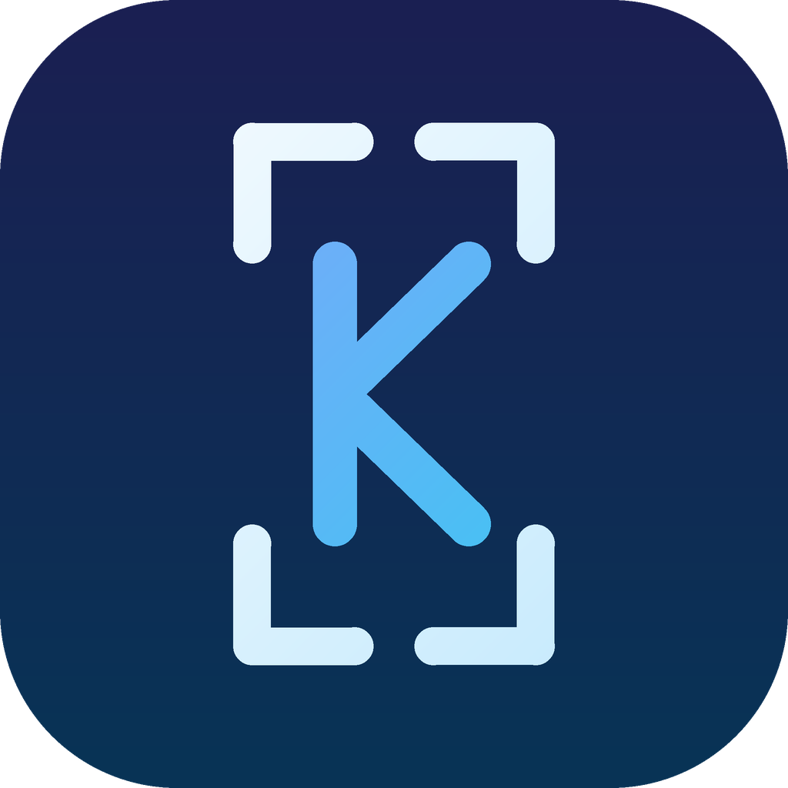

<div align="center">



# Kadr

**A local-first AI video editor for Shorts, Reels and TikTok.**
Captions with word-level timing, vertical shorts cut from long videos, dead-air removal and export — on your own computer.

</div>

---

## What it does

- **Captions.** Speech recognition with word timestamps (local Whisper, or Groq in the cloud with your own key). English, Russian and other languages. Fix names with a glossary, paste a script to re-text the captions, edit and add words on the timeline, see which words the recognizer was unsure about.
- **Shorts.** Finds 25–60 second self-contained highlights in a long video (English, Russian, romanized Urdu/Hindi) and lets you trim, rename, add and delete them.
- **Subtitle styles.** 100+ presets, with the same look in the preview and in the exported video (fonts, outline, shadow, boxes, emoji above the text).
- **Editing.** Razor, ripple delete of silence, B-roll from Pexels (your key), undo / redo.
- **YouTube import.** Download a video you have the right to use straight into the editor.
- **Projects.** Save the whole session to a `.kadr` file and open it later.
- **Export.** Hardware accelerated (NVENC, QuickSync, AMF, VideoToolbox) with a software fallback, saved to the folder you choose.

Everything runs on your machine. Nothing is sent anywhere unless you choose the cloud engine (Groq) or configure analytics yourself (there is no built-in analytics server).

## Install

Download the installer from the [latest release](https://github.com/Raymond0385/YT/releases/latest) (Windows `.exe`, macOS `.dmg`). Python, FFmpeg and the speech engine are bundled.

The app checks this repository's releases for updates (Settings → Updates). Set `CAPSHORTS_UPDATE_REPO=owner/name` to use another repository.

## Run from source

```bash
# backend (Python 3.11+)
cd CapShorts/backend
python -m venv venv && venv/Scripts/pip install -r requirements.txt   # Windows; use venv/bin/pip elsewhere
venv/Scripts/python engine.py                                          # http://127.0.0.1:8000

# frontend (Node 22+), in a second terminal
cd CapShorts/frontend
npm install && npm run dev                                             # http://localhost:5173
```

FFmpeg, ffprobe and `qjs` (a small JavaScript engine used to read YouTube) go into `CapShorts/backend/bin`.
Tests: `python -m pytest` in `CapShorts/backend`, `npm test` in `CapShorts/frontend`.

Build the installer: `cargo tauri build` in `CapShorts` (see `.github/workflows/release.yml` for the full pipeline).

## Русский

Kadr — локальный редактор видео для Shorts: субтитры с таймингами слов, нарезка вертикальных шортсов из длинных роликов, удаление пауз, экспорт. Работает на вашем компьютере. Проекты сохраняются в файлы `.kadr`. Установщик — на странице [релизов](https://github.com/Raymond0385/YT/releases/latest).

## Credits and license

Kadr started from the open-source project **CapShorts** by Ali Raza (MIT License) and has since been changed substantially. The original copyright notice is kept in [LICENSE](./LICENSE).

Bundled third-party assets: Noto Emoji (Apache 2.0), Montserrat, Inter, Poppins, Noto Nastaliq Urdu, Gulzar and Anton fonts (SIL Open Font License), FFmpeg (GPL build), QuickJS-ng (MIT), yt-dlp (Unlicense).
Only download videos you own or have permission to use.
